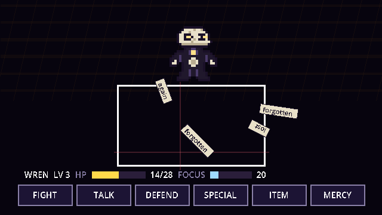
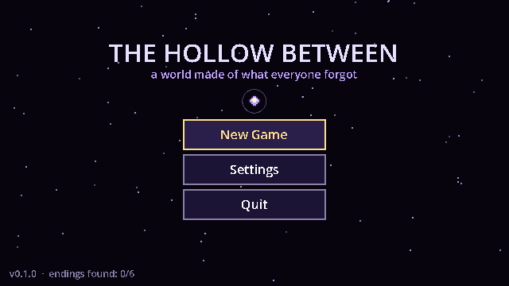
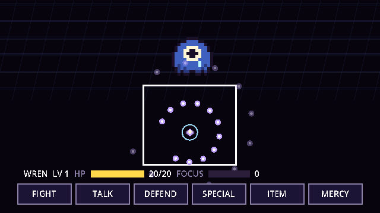
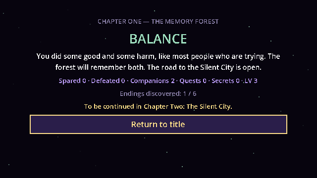

<h1 align="center">🌌 The Hollow Between</h1>

<p align="center"><i>A story-rich pixel RPG about a world made of everything that was forgotten.</i></p>

<p align="center">
  <a href="https://jaigod.github.io/the-hollow-between/"></a>
</p>

<p align="center">
  
  
  
  
  
</p>

<p align="center">
  <a href="https://jaigod.github.io/the-hollow-between/play/"></a>
</p>

You wake in **the Hollow Between** — a dimension built from lost memories, abandoned dreams and erased histories. Nobody remembers how they got there. Every NPC has a secret, every enemy has a story, and every choice you make is remembered.

Built in **Godot 4.4** (GDScript only). Plays in the browser, on desktop and on phones.

## 🎮 Play

**[▶ Play in browser](https://jaigod.github.io/the-hollow-between/)** — landing page · **[jump straight into the game](https://jaigod.github.io/the-hollow-between/play/)**

| Action | Keyboard | Gamepad / phone |
|---|---|---|
| Move / steer your soul | Arrows or WASD | Stick / D-pad · on-screen D-pad |
| Confirm, talk, jump (gravity zones) | Z or Enter | A · on-screen Z |
| Cancel, run (hold) | X or Shift | B · on-screen X |
| Menu (status, quests, party, talents, items, settings) | C or Esc | Start · ≡ button |

Progress saves at glowing lanterns (3 slots + autosave). Sound and music volume are in **Settings**.

## 📸 Screenshots

| | | |
|---|---|---|
|  |  |  |
| **Title** — changes once you've seen an ending | **Soul phase** — find the gap in the closing ring | **Endings** — six, decided by everything you did |

## ✨ What's playable now — Chapter 1: The Memory Forest

A complete vertical slice (~30–45 minutes) with every core system working:

- **5 areas** — Glade of Waking, Whispering Path, the village of Lanternrest, the Archive Grove, and a secret area most players will never find
- **Battle system** — FIGHT (timed hits, crits, 3-hit combos) · TALK (Reason / Joke / Comfort / Intimidate / Question — every enemy reacts differently) · DEFEND · SPECIAL · ITEM · MERCY (spare or flee)
- **Bullet-hell defense** — steer your soul through 8 attack patterns: falling shards, closing orbit rings, energy beams, explosive mines, sine-wave walls, gravity zones (jump!), teleporting eyes, and the Archivist's pages — inscribed with words from *your own history*
- **Grazing** — brushing past bullets builds Focus, which powers Specials
- **Boss: The Archivist** — 3 phases that advance by damage *or* by turns survived, so pacifists progress too; it reads your kill count back to you
- **Companions** — Echo (healer) and the Clockmaker (time) with loyalty that rises and falls with your choices, battle summons, and party following
- **Choices that matter** — every decision is recorded; NPCs, bosses, dialogue and the ending react to it
- **6 endings** — True Hope, Balance, Isolation, Corruption, a Secret ending, and a Developer Mystery ending that requires knowledge from a previous playthrough
- **Skill trees** — Guardian, Ranger, Mystic, Chronomancer; mix freely for hybrid builds
- **Quests, puzzle, shop, save lanterns**, 3 save slots + autosave, cross-save profile ("it remembers you")
- **Procedural chiptune** music & SFX with character motifs and adaptive boss intensity — no audio files needed
- **Pixel-art pipeline** — sprites and tiles are data; drop PNGs in to replace them
- **Day/night cycle, dynamic lantern lighting, weather** (fireflies, memory motes, ink rain, stars)
- **Touch controls** on phones/tablets, keyboard and gamepad everywhere
- **Steam achievements** bridge (GodotSteam), cloud-save-ready architecture
- **Automated tests** — a headless smoke test plays every map, dialogue, enemy, pattern, special, save/load and the ending on every push

## 🛠 Tech stack

| Layer | What |
|---|---|
| Engine | Godot 4.4, GL Compatibility renderer, 640×360 canvas scaled with pixel snapping |
| Code | GDScript only, one scene built in code, signal bus, no `class_name` dependencies |
| Content | JSON in `data/` (enemies, dialogue, quests, talents, items, endings, maps) |
| Art & audio | Sprites defined as text in `SpriteLib.gd`; ASCII maps baked to textures; chiptune synthesized at runtime |
| CI / hosting | GitHub Actions + `barichello/godot-ci:4.4.1` → smoke test → Web export (threads off) → GitHub Pages |

## 📁 Project structure

```
project.godot            engine config, autoloads
export_presets.cfg       Windows, Linux, macOS, Web, Android, iOS
scenes/Main.tscn         the only scene: everything else is built in code
scripts/
  Main.gd                router: title ↔ overworld ↔ battle ↔ ending
  autoload/              Events, InputConfig, DB, GameState, SaveManager, AudioManager, Achievements
  world/                 Overworld, Player, WorldEntity
  battle/                Battle (turn flow), BattleArena (soul & bullets), Bullet, patterns/
  ui/                    DialogueBox, TitleScreen, PauseMenu, SaveSlotMenu, Settings, TouchControls, EndingScreen
  art/                   SpriteLib (text → pixel sprites), TileBaker (ASCII maps → textures)
  systems/ save/         EndingResolver, LocalSaveBackend
data/                    all content as JSON (maps/ and dialogue/ too)
tools/build_maps.py      map authoring + validation (widths, walkability, reachability)
tests/                   SmokeTest (headless, 92 checks) + Screenshots scenes
web/index.html           GitHub Pages landing page (the game is exported to /play/)
docs/                    design docs + screenshots
```

## 🚀 Run locally

1. Install [Godot 4.4+](https://godotengine.org/download) (standard, not .NET).
2. Clone and open:
   ```bash
   git clone https://github.com/JaiGod/the-hollow-between.git
   ```
   In Godot: **Import → select `project.godot` → Edit**, then press **F5**.

Run the tests and tools:

```bash
godot --headless --path . res://tests/SmokeTest.tscn   # prints "SMOKE OK"
python3 tools/build_maps.py                           # validates + regenerates all maps
xvfb-run godot --path . res://tests/Screenshots.tscn  # regenerates docs/screenshots
```

Web build: `godot --headless --path . --export-release "Web" build/web/index.html`, then `python3 -m http.server -d build/web`.

## 📚 Docs

| Guide | What's in it |
|---|---|
| [Setup](docs/SETUP.md) | Install, run, project layout |
| [Architecture](docs/ARCHITECTURE.md) | Systems, data flow, how to extend |
| [Story Design](docs/STORY_DESIGN.md) | World, characters, endings, writing dialogue |
| [Combat Design](docs/COMBAT_DESIGN.md) | Battle math, patterns, bosses, adding enemies |
| [Build Instructions](docs/BUILD.md) | Windows / Mac / Linux / Web / Android / iOS / Steam |
| [Mobile Optimization](docs/MOBILE.md) | Touch, performance, store prep |

## 📝 Development log

- **Engine choice.** Godot over Unity: a 2D-first engine, tiny exports, GDScript makes dialogue and menu systems quick to write, and bullet patterns are easy to script.
- **Content as data.** Every enemy, conversation, quest, talent, map and ending is JSON, driven by a small condition/effect language (`flag:x`, `stat:killed>=3`, `loyalty:echo>=40` …). New content rarely needs new code.
- **One scene, built in code.** Screens are created with `.new()` and scripts `preload()` each other instead of relying on `class_name`, so a fresh clone (and CI) runs without the editor's class cache.
- **Bullets without nodes.** Projectiles are plain objects drawn in one `_draw()` per frame, so 100+ bullets cost almost nothing on phones and in the browser.
- **Pacifists still see the whole boss.** Boss phases trigger by HP *or* by turns survived, so talking your way through the Archivist still shows every phase.
- **Map validation.** Maps are ASCII in `tools/build_maps.py`; the first run caught rows of the wrong width and items placed inside walls, so the script now checks widths, walkability, exits and reachability.
- **Bugs the smoke test caught.** Freed dialogue/battle buttons lingered for a frame and received input (fixed by removing children before `queue_free()`), dialogue events were routed through `current_scene` (broke under the test harness; now passed to `Main` directly), and strict type inference errors on `:=` with mixed types.
- **Polish pass.** Companions now stand behind you when a map loads instead of stacking on the player; area titles got an outline so they read over bright tiles; the title layout was tightened.
- **Web build.** Exported with threads disabled so it runs on GitHub Pages without COOP/COEP headers; the "Quit" button hides on web and mobile.
- **Recovery (Nov 2026).** The original repository lived on a GitHub account that was suspended. The project was rebuilt file-by-file from the development transcript, re-validated with Godot 4.4.1 (smoke test 92/92), re-exported for Web and re-published here under **JaiGod** with a landing page and a Pages workflow. The gameplay trailer and GIF from the first release were not recoverable.

## 🗺 Roadmap

- **Chapter 2 — The Silent City:** The Wanderer joins; The Forgotten King (arena constantly changes)
- **Chapter 3 — The Glass Desert:** Nyra; reflection puzzles
- **Chapter 4 — The Broken Observatory:** time distortions; The Puppeteer (controls your companions)
- **Chapter 5 — The Dreaming Ocean:** The Hollow Beast (multi-phase)
- **Finale — Heart of the Hollow:** a final boss that responds to your entire history

## 📄 License

Code: [MIT](LICENSE). Story, characters and world are original works by Jaineil Rana (JaKing). All art and audio are generated in code.

---

<p align="center">Made by Jaineil Rana (JaKing) · part of <a href="https://github.com/JaiGod">JaiGod</a></p>
